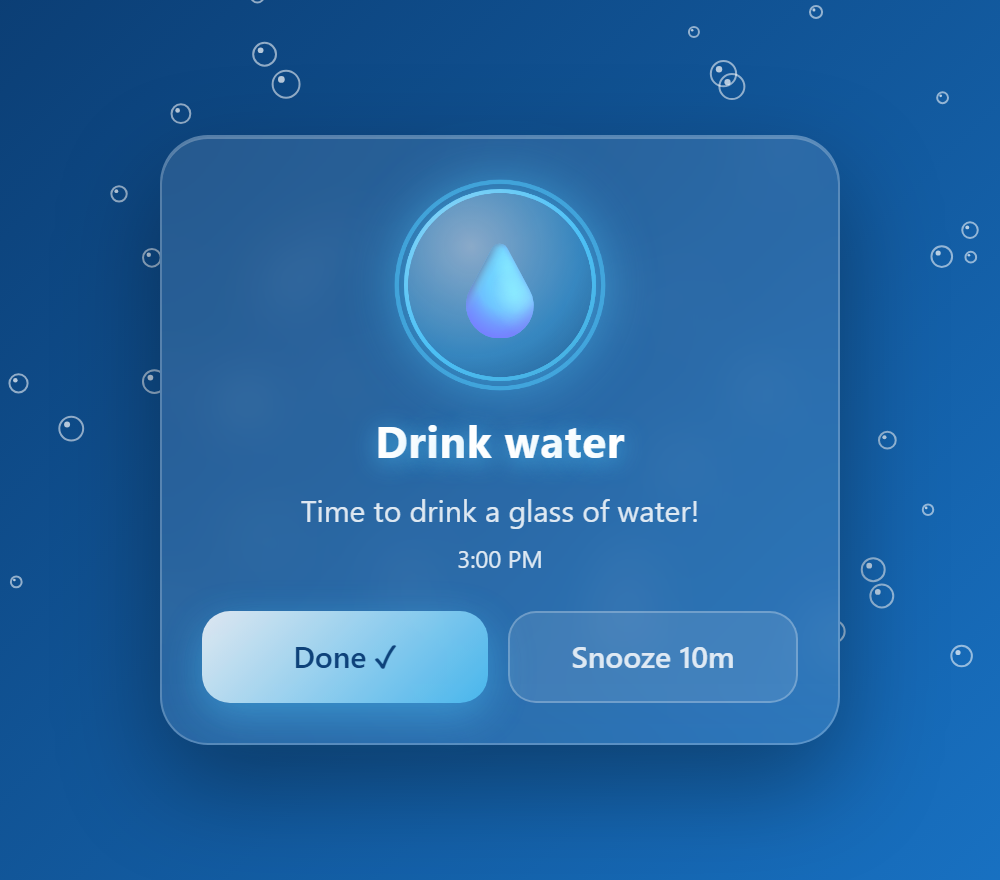
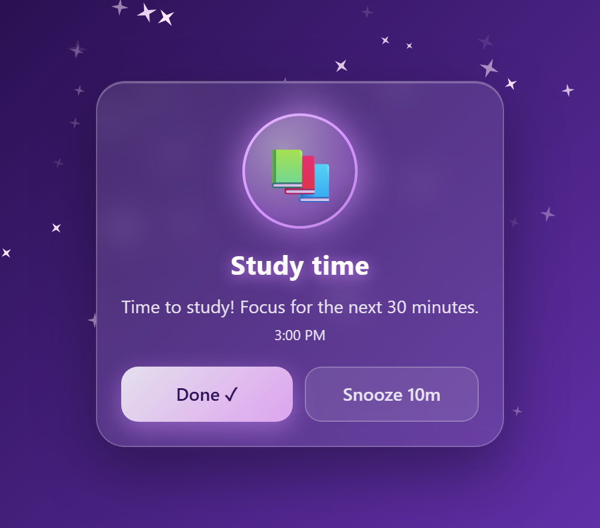
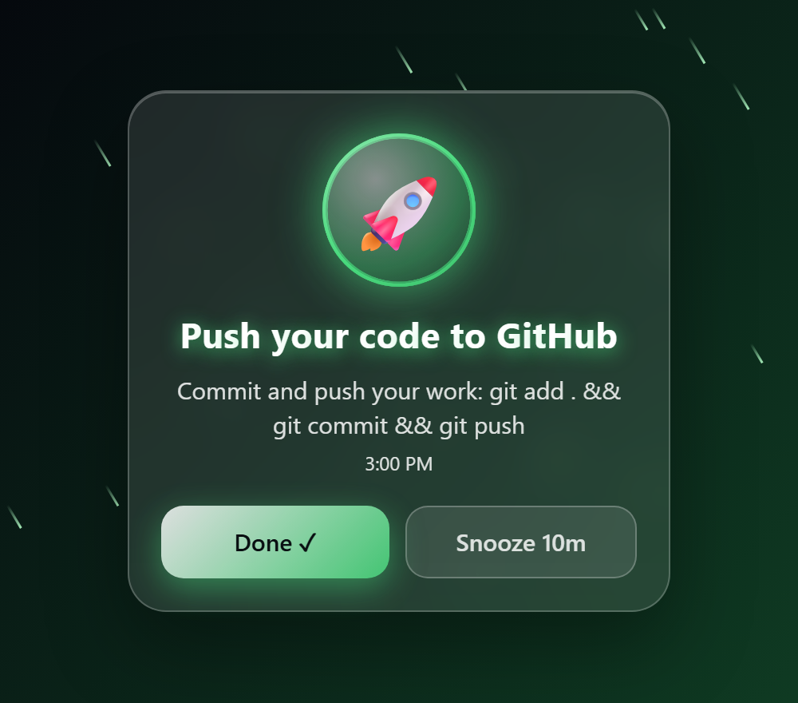
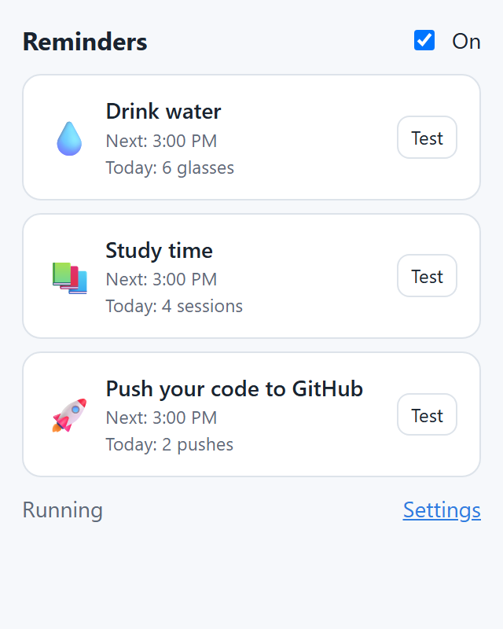
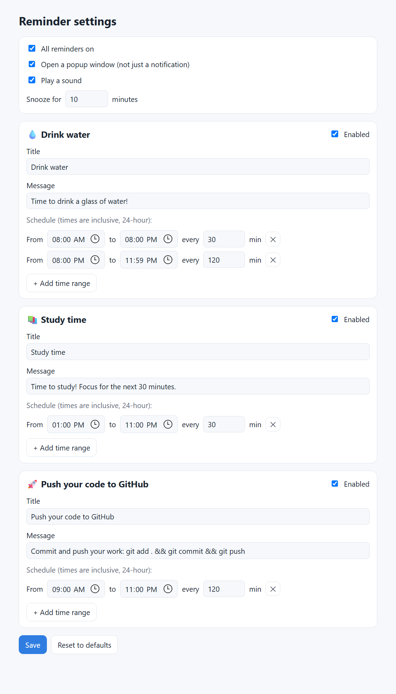

# 💧📚🚀 Water, Study & GitHub Reminder

A Chrome / Edge extension that pops up **animated reminders** to drink water, study, and push your code to GitHub, on a schedule you control.

<p align="center">
  
  
  
</p>

## Features

- **Pop-out reminder window** plus a system notification, so you can't miss it
- **A different animated theme for each reminder**: rising bubbles for water, twinkling sparkles for study, shooting stars for GitHub
- **Done ✓** sets off a confetti burst and the icon flies away. **Snooze** brings the reminder back later
- **Daily counter**: glasses of water, study sessions and pushes done today
- **Fully customizable**: any time range, any interval, your own titles and messages
- Short chime sound (can be turned off)

## Default schedule

| Reminder | When |
|---|---|
| 💧 Drink water | Every **30 min** from 8:00 AM to 8:00 PM, then every **2 hours** after 8 PM (10:00 PM) |
| 📚 Study | Every **30 min** from 1:00 PM to 11:00 PM |
| 🚀 Push code to GitHub | Every **2 hours** from 9:00 AM to 11:00 PM |

## Screenshots

| Toolbar popup | Settings |
|---|---|
|  |  |

---

## 🖥️ Setup on your desktop (Windows)

### Step 1: Get the code

**Option A: with Git** (recommended, so updating is easy)

```bash
git clone https://github.com/suyogkarki1/water-study-reminder.git
```

**Option B: without Git**

1. Open https://github.com/suyogkarki1/water-study-reminder
2. Click the green **Code** button, then **Download ZIP**
3. Right-click the ZIP, choose **Extract All…**, and pick a folder you won't delete (for example `Documents\water-study-reminder`)

> ⚠️ Keep this folder where it is. The browser loads the extension straight from it, so if you delete or move it, the extension stops working.

### Step 2: Load it into your browser

**Google Chrome**

1. Type `chrome://extensions` in the address bar and press Enter
2. Turn on **Developer mode** (toggle in the top-right corner)
3. Click **Load unpacked**
4. Select the `water-study-reminder` folder (the one that contains `manifest.json`)

**Microsoft Edge**

1. Go to `edge://extensions`
2. Turn on **Developer mode** (left sidebar)
3. Click **Load unpacked** and select the same folder

### Step 3: Pin it to the toolbar

Click the puzzle-piece icon 🧩 next to the address bar, then click the pin 📌 next to **Water, Study & GitHub Reminder**.
Click the blue drop icon to see your next reminders. Click **Test** to preview a popup right away.

### Step 4: Allow notifications in Windows

1. Open **Settings → System → Notifications**
2. Make sure **Notifications** is on, and that **Google Chrome** (or **Microsoft Edge**) is turned on in the app list
3. If **Do not disturb** / **Focus** is on, reminders will be silent. Turn it off or add Chrome as an allowed app

### Step 5: Keep reminders running when the browser is closed (optional)

Reminders only appear while the browser is running. To get them even when all windows are closed:

- **Chrome:** Settings → System → turn on **Continue running background apps when Google Chrome is closed**
- **Edge:** Settings → System and performance → turn on **Continue running background extensions and apps when Microsoft Edge is closed**

To have the browser start with Windows, enable it in **Task Manager → Startup apps** (if it's listed), or put a browser shortcut in the startup folder (`Win + R` → `shell:startup`).

### Step 6: Customize (optional)

Click the toolbar icon, then **Settings**. From there you can:
- change the time ranges and intervals, or add more ranges with **+ Add time range**
- edit each reminder's title and message
- turn the popup window, sound or individual reminders on or off
- change how long Snooze lasts

Click **Save** when you're done.

---

## 🔄 Updating

If you used Git:

```bash
cd water-study-reminder
git pull
```

Then open `chrome://extensions` and click the **↻ reload** icon on the extension card.
If you downloaded the ZIP, download it again, replace the folder's contents, and click reload.

## ❓ Troubleshooting

| Problem | Fix |
|---|---|
| No reminders show up | Check that the **On** switch in the toolbar popup is ticked and the current time falls inside a schedule range |
| Popup shows but no Windows notification | Allow notifications for Chrome/Edge (Step 4) and turn off Do Not Disturb |
| Reminders stop when I close the browser | Enable background apps (Step 5) |
| A reminder was missed while the PC was asleep | Expected. Reminders more than 5 minutes late are skipped so you don't get a pile of popups when the PC wakes up |
| "Developer mode extensions" warning on startup | Normal for extensions loaded from a folder. Just close it |

## 📁 Project structure

```
manifest.json     Extension manifest (Manifest V3)
background.js     Scheduler: checks every minute and opens reminders
config.js         Default schedule + shared time helpers
reminder.html/js  Animated pop-out reminder window
popup.html/js     Toolbar popup (next reminders, today's counts)
options.html/js   Settings page
styles.css        Shared styles (light & dark mode)
icons/            Extension icons
docs/screenshots/ Images used in this README
```
